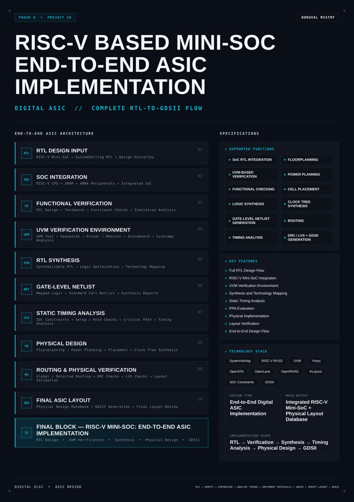
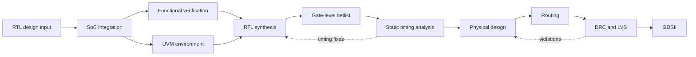
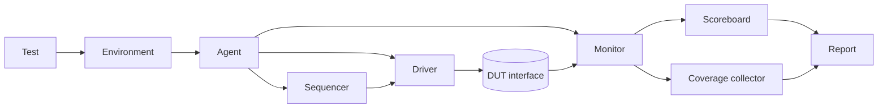
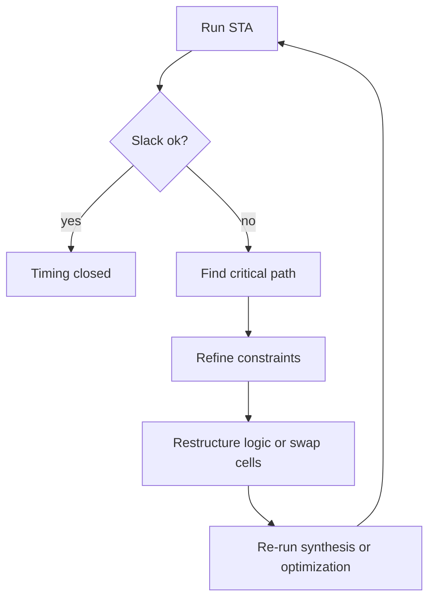
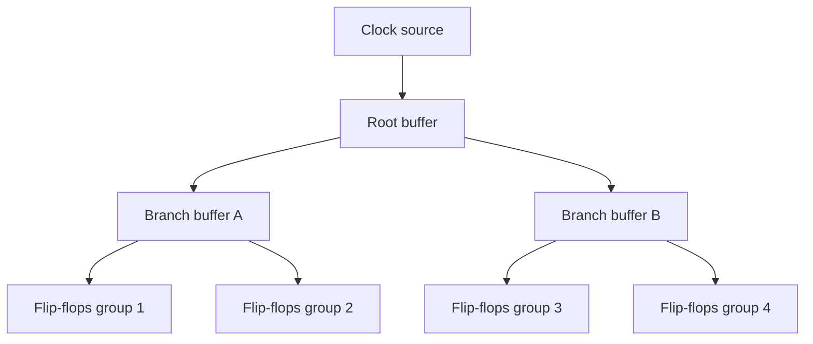

<div align="center">




<b>An end-to-end digital ASIC flow for a RISC-V mini-SoC: SystemVerilog RTL, UVM-based verification, logic synthesis, static timing analysis, floorplanning, placement, clock tree synthesis, routing, DRC and LVS checks, and GDSII generation.</b>

<br/>


<br/>

[Overview](#overview) |
[At a Glance](#project-at-a-glance) |
[Background](#background-the-asic-flow) |
[Functions](#supported-functions) |
[Architecture](#architecture) |
[Flow Stages](#flow-stages) |
[SoC Integration](#soc-integration) |
[Verification](#functional-verification) |
[UVM](#uvm-verification-environment) |
[Synthesis](#rtl-synthesis-and-gate-level-netlist) |
[STA](#static-timing-analysis) |
[Physical Design](#physical-design) |
[Routing and Checks](#routing-and-physical-verification) |
[GDSII](#final-layout-and-gdsii) |
[Getting Started](#getting-started) |
[Sign-off](#sign-off-checklist) |
[FAQ](#faq) |
[License](#license)

</div>

---

## Overview

This project takes a **RISC-V mini-SoC** all the way from source code to a manufacturable layout database. It is not a single block. It is the **complete digital ASIC flow**, applied to a small system-on-chip that contains a **RISC-V RV32I CPU**, an **SRAM** and a set of **AMBA peripherals**.

The flow starts with **SystemVerilog RTL** and its design hierarchy. The CPU, memory and peripherals are **integrated** into one SoC and checked by **functional verification**: a testbench runs programs, observes the bus and compares the results with expected behaviour. A **UVM verification environment** adds a structured, reusable, coverage-driven layer on top, made of a test, sequences, a driver, a monitor, a scoreboard and coverage collection.

Once the RTL is trusted, it goes through **logic synthesis**: the RTL is optimized and mapped onto a **standard cell library**, producing a **gate-level netlist** and synthesis reports. The netlist is checked by **static timing analysis (STA)** against **SDC constraints**, looking at setup and hold paths, the critical path and slack. **Physical design** then turns the netlist into a layout: **floorplanning**, **power planning**, **cell placement** and **clock tree synthesis**. **Global and detailed routing** connect the cells, and **DRC** and **LVS** checks confirm that the layout obeys the manufacturing rules and matches the netlist. The last step is **GDSII generation** and a final layout review.

The flow is built on open-source tools so that every step can be reproduced: **Verilator** for RTL simulation, **Yosys** for synthesis, **OpenSTA** for timing, **OpenLane and OpenROAD** for physical implementation and **KLayout** for layout viewing and checks. Every figure that the flow produces (area, frequency, power, violation counts) is recorded in generated reports and listed as `TBD` in this document until it has been measured.

<table>
<tr>
<td width="50%" valign="top">

#### Objectives
- Build a complete RTL-to-GDSII flow for a RISC-V mini-SoC
- Integrate a RISC-V CPU, SRAM and AMBA peripherals into one SoC
- Verify the SoC functionally and with a UVM environment
- Synthesize the RTL into a gate-level netlist with standard cells
- Analyze setup and hold timing and close timing against SDC constraints
- Implement the design physically: floorplan, power, placement, clock tree, routing
- Validate the layout with DRC and LVS and generate the GDSII database

</td>
<td width="50%" valign="top">

#### Key Features
- Full RTL design flow
- RISC-V mini-SoC integration
- UVM verification environment
- Synthesis and technology mapping
- Static timing analysis
- PPA evaluation
- Physical implementation
- Layout verification
- End-to-end design flow

</td>
</tr>
</table>

---

## Project at a Glance

| Attribute | Detail |
|:--|:--|
| **Design type** | End-to-end digital ASIC implementation |
| **Design under flow** | RISC-V mini-SoC (CPU, SRAM, AMBA peripherals) |
| **Description language** | SystemVerilog (RTL) |
| **Instruction set** | RISC-V RV32I |
| **Verification** | Functional testbench and UVM environment |
| **Synthesis** | Yosys, standard cell technology mapping |
| **Timing** | OpenSTA with SDC constraints |
| **Physical design** | OpenLane and OpenROAD (floorplan, power, placement, CTS, routing) |
| **Layout checks** | DRC and LVS |
| **Layout viewer** | KLayout |
| **Technology** | Open process design kit, TBD (selected in the flow configuration) |
| **Target clock frequency** | TBD |
| **Core area** | TBD |
| **Power** | TBD |
| **Main output** | Integrated RISC-V mini-SoC and physical layout database (GDSII) |
| **Implementation scope** | RTL, verification, synthesis, timing analysis, physical design, GDSII |
| **License** | MIT |

---

## Background: The ASIC Flow

An **application-specific integrated circuit (ASIC)** starts as a description of behaviour and ends as a set of **masks** that a foundry uses to build silicon. Between the two sits a long chain of steps, each one transforming the design into a form that is closer to the physical chip and checking that nothing was lost on the way.

**Front-end and back-end.** The flow is usually split in two halves. The **front-end** works on the logical design: writing RTL, verifying it, synthesizing it into gates and checking the timing of those gates. The **back-end** works on the physical design: deciding where each cell sits, how power and clock reach it, how wires connect it, and whether the final geometry is legal. This project covers both halves in one repository.

**Why verification comes first.** A bug found in RTL costs a code change. The same bug found after layout can cost a full re-run of the flow, and a bug found in silicon costs a new chip. Functional verification and the UVM environment therefore sit before synthesis, and the gate-level netlist can be re-simulated later to confirm that synthesis kept the behaviour.

**Why timing drives everything.** A design only works at a clock frequency when every path between registers finishes within one clock period. Synthesis tries to meet this with the cells it chooses. Static timing analysis checks it without simulation. Placement, clock tree synthesis and routing all change wire delays, so timing is checked again after each of them. This repeated check is the thread that ties the flow together.

**Why physical checks matter.** A layout can be electrically correct and still be unmanufacturable. **Design rule checking (DRC)** confirms that the geometry respects the minimum widths, spacings and densities of the process. **Layout versus schematic (LVS)** confirms that the connectivity extracted from the layout matches the synthesized netlist. A clean DRC and a clean LVS are the entry ticket to GDSII hand-off.

**Why a mini-SoC.** A RISC-V mini-SoC is small enough to run through an open-source flow in reasonable time, and complete enough to exercise everything that matters: sequential logic, a memory, a bus, peripherals, a clock tree and a real power grid.

---

## Supported Functions

| Function | Description |
|:--|:--|
| **SoC RTL integration** | Connects the RISC-V CPU, SRAM and AMBA peripherals into one top level |
| **UVM-based verification** | Reusable class-based environment with a test, sequences, driver, monitor, scoreboard and coverage |
| **Functional checking** | Compares observed behaviour with expected results |
| **Logic synthesis** | Converts RTL into optimized logic |
| **Gate-level netlist generation** | Produces a netlist of standard cells with synthesis reports |
| **Timing analysis** | Setup and hold checks, critical path and slack reports |
| **Floorplanning** | Defines die and core area, macro and pin placement |
| **Power planning** | Builds power rings, stripes and the power grid |
| **Cell placement** | Places standard cells and optimizes the placement |
| **Clock tree synthesis** | Builds a balanced clock distribution network |
| **Routing** | Global routing and detailed routing of all signal nets |
| **DRC and LVS** | Design rule and layout versus schematic verification |
| **GDSII generation** | Writes the final layout database |
| **Final design review** | Collects reports and checks sign-off criteria |

---

## Architecture

The design is organized as a **pipeline of stages**. Each stage takes the output of the previous one, produces a new representation of the same SoC and a set of reports, and hands both to the next stage.

```
                         RISC-V MINI-SOC: RTL TO GDSII

   +------------------------------------------------------------------+
   | 01  RTL DESIGN INPUT      SystemVerilog RTL, design hierarchy    |
   +------------------------------------------------------------------+
                                   |
   +------------------------------------------------------------------+
   | 02  SOC INTEGRATION       RISC-V CPU + SRAM + AMBA peripherals   |
   +------------------------------------------------------------------+
                                   |
        +--------------------------+--------------------------+
        |                                                     |
   +-----------------------------------+      +-----------------------------------+
   | 03  FUNCTIONAL VERIFICATION       |      | 04  UVM VERIFICATION ENVIRONMENT  |
   | testbench, checks, simulation     |      | test, sequences, driver, monitor, |
   |                                   |      | scoreboard, coverage              |
   +-----------------------------------+      +-----------------------------------+
        |                                                     |
        +--------------------------+--------------------------+
                                   |
   +------------------------------------------------------------------+
   | 05  RTL SYNTHESIS         optimization, technology mapping       |
   +------------------------------------------------------------------+
                                   |
   +------------------------------------------------------------------+
   | 06  GATE-LEVEL NETLIST    standard cell netlist, synthesis rpts  |
   +------------------------------------------------------------------+
                                   |
   +------------------------------------------------------------------+
   | 07  STATIC TIMING ANALYSIS  SDC, setup/hold, critical path       |
   +------------------------------------------------------------------+
                                   |
   +------------------------------------------------------------------+
   | 08  PHYSICAL DESIGN       floorplan, power, placement, CTS       |
   +------------------------------------------------------------------+
                                   |
   +------------------------------------------------------------------+
   | 09  ROUTING AND PHYSICAL VERIFICATION   global/detailed, DRC, LVS|
   +------------------------------------------------------------------+
                                   |
   +------------------------------------------------------------------+
   | 10  FINAL ASIC LAYOUT     layout database, GDSII, final review   |
   +------------------------------------------------------------------+
```



### Block Breakdown

| No. | Block | Role |
|:--:|:--|:--|
| 01 | **RTL design input** | SystemVerilog sources and design hierarchy for the RISC-V mini-SoC |
| 02 | **SoC integration** | RISC-V CPU, SRAM and AMBA peripherals connected into an integrated SoC |
| 03 | **Functional verification** | RTL design, testbench, functional checks and simulation analysis |
| 04 | **UVM verification environment** | UVM test, sequences, driver and monitor, scoreboard, coverage analysis |
| 05 | **RTL synthesis** | Synthesizable RTL, logic optimization, technology mapping |
| 06 | **Gate-level netlist** | Mapped logic as a standard cell netlist, plus synthesis reports |
| 07 | **Static timing analysis** | SDC constraints, setup and hold checks, critical path, timing analysis |
| 08 | **Physical design** | Floorplanning, power planning, placement, clock tree synthesis |
| 09 | **Routing and physical verification** | Global and detailed routing, DRC checks, LVS checks, layout validation |
| 10 | **Final ASIC layout** | Physical design database, GDSII generation, final layout review |

> **Final design block:** the RISC-V mini-SoC, taken through RTL design, UVM verification, synthesis, physical design and GDSII.

---

## Flow Stages

| Stage | Input | Tool | Output | Main check |
|:--|:--|:--|:--|:--|
| RTL design | Specification | Editor, Verilator lint | SystemVerilog sources | Lint clean |
| SoC integration | CPU, SRAM, peripherals | Verilator | Top-level RTL | Address map and port connectivity |
| Functional verification | RTL, testbench | Verilator, GTKWave | Logs, waveforms | Tests pass |
| UVM verification | RTL, UVM environment | UVM-capable simulator | Coverage and scoreboard report | Coverage closure, TBD |
| Synthesis | RTL, liberty file, SDC | Yosys | Gate-level netlist, reports | Netlist builds and equals RTL behaviour |
| Netlist simulation | Netlist, cell models | Verilator or simulator | Logs | Same results as RTL |
| Static timing analysis | Netlist, SDC, liberty | OpenSTA | Timing reports | Setup and hold slack not negative |
| Floorplan | Netlist, constraints | OpenROAD | Floorplan database | Area and pin plan accepted |
| Power planning | Floorplan | OpenROAD | Power grid | Power grid connected |
| Placement | Floorplan | OpenROAD | Placed design | No overlap, congestion acceptable |
| Clock tree synthesis | Placed design | OpenROAD | Clocked design | Skew within target |
| Routing | Clocked design | OpenROAD | Routed design | No unrouted nets |
| DRC | Layout | KLayout, Magic | DRC report | Zero violations |
| LVS | Layout, netlist | Netgen | LVS report | Layout matches netlist |
| GDSII | Routed, checked design | KLayout | GDSII file | Final review passed |

---

## Functional Description

### RTL design input

The starting point is the **RTL source set**: SystemVerilog modules arranged in a clear **design hierarchy** with a single top level. The RTL is written in a **synthesizable subset**, which means no delays, no unsynthesizable constructs and explicit resets, so that the same source can be simulated and synthesized. A lint step catches width mismatches, latches and unused signals before any other tool runs.

### SoC integration

The integrated SoC contains three groups of blocks.

| Group | Contents | Role |
|:--|:--|:--|
| **CPU** | RISC-V RV32I core | Fetches and executes instructions and issues bus accesses |
| **Memory** | SRAM and its controller | Holds instructions and data |
| **Peripherals** | AMBA-connected blocks such as UART, GPIO and timer | Let software communicate with the outside world |

The pieces are connected by an **AMBA bus** with **address decoding**, so that every CPU access reaches the memory or the peripheral that owns the address. The exact peripheral set and bus protocol are fixed in the RTL and recorded in the memory map document of the repository, `TBD` until final.

### Functional verification

The functional testbench applies a clock and reset, loads a program into the SRAM, lets the CPU run and checks the result through the bus and the chip pins. Checks are self-checking: the testbench compares observed values with expected values and reports pass or fail. Waveforms are dumped for debugging.

### UVM verification environment

The UVM environment verifies the bus-facing behaviour of the SoC in a structured and reusable way. It is described in detail in its own section below.

### RTL synthesis and gate-level netlist

Synthesis converts the RTL into a network of **logic gates** taken from a **standard cell library**. It performs **logic optimization**, then **technology mapping**, and writes a **gate-level netlist** with reports on area, cell usage and, with constraints, estimated timing.

### Static timing analysis

STA examines every timing path in the netlist without needing test vectors. It reads the **SDC constraints**, the netlist and the cell timing models, and reports **setup** and **hold** slack, the **critical path** and the paths that fail.

### Physical design

Physical design places the netlist on silicon. It covers **floorplanning**, **power planning**, **standard cell placement** and **clock tree synthesis**.

### Routing and physical verification

**Global routing** plans the wire paths and **detailed routing** draws the metal. **DRC** and **LVS** then validate the result.

### Final ASIC layout

The routed and verified design is written as a **GDSII** file, the layout database exchanged with a foundry, and reviewed against the sign-off checklist.

---

## SoC Integration

### Top-level structure

```
soc_top
  |-- cpu            RISC-V RV32I core
  |-- sram_ctrl      SRAM controller
  |-- sram           memory array or macro
  |-- bus            AMBA interconnect and address decoder
  |-- uart           serial peripheral
  |-- gpio           digital input and output peripheral
  |-- timer          counter peripheral
  |-- clk_rst        clock and reset distribution
```

The peripheral list above is the intended set. The exact list is confirmed in `rtl/soc_top.sv`.

### Connection rules

| Rule | Reason |
|:--|:--|
| One top-level clock and one active-low reset, distributed to every block | Keeps the clock tree and reset tree simple |
| All peripherals accessed through memory-mapped registers | Software sees the SoC as plain addresses |
| Address decoding in one place only | A single source of truth for the memory map |
| No combinational path from a bus input to a bus output across blocks without a register, unless documented | Avoids long timing paths |
| Registers reset to a known value | Needed for repeatable simulation and for synthesis |

### Memory map

| Region | Base address | Size | Owner |
|:--|:--|:--|:--|
| SRAM | TBD | TBD | SRAM controller |
| UART registers | TBD | TBD | UART |
| GPIO registers | TBD | TBD | GPIO |
| Timer registers | TBD | TBD | Timer |

An access outside these regions returns a bus error response, TBD in the final bus configuration.

### SRAM in the ASIC flow

An SRAM can be implemented in two ways. A **behavioural array** synthesizes into flip-flops or latches, which costs area and is practical only for a very small memory. A **memory macro** from the process kit or a memory compiler is a pre-built block that the floorplan places as a fixed object. The choice changes the floorplan and the power planning, so it is recorded in the flow configuration as `TBD` until chosen.

---

## Functional Verification

### Test plan

| Test | Purpose | Pass criterion |
|:--|:--|:--|
| Reset | All registers at reset values, CPU starts at the boot address | Observed values equal expected |
| Instruction fetch | CPU reads instructions from SRAM | Program counter advances correctly |
| Data access | Loads and stores to SRAM | Read data equals written data |
| Register file and ALU | A mixed arithmetic program | Result matches a software model |
| Peripheral registers | Read and write each register | Reset values and write effects as specified |
| UART transmit | Write a byte to the UART | Correct serial frame on the output pin |
| GPIO | Drive outputs and sample inputs | Pins follow registers and the reverse |
| Timer | Start the timer and wait | Counter and status behave as specified |
| Invalid address | Access an unmapped address | Error response, no side effects |
| Back-to-back accesses | Consecutive bus transactions | No lost or duplicated transfer |

### Assertions

| Assertion | Property |
|:--|:--|
| Reset value | Registers hold reset values while reset is active |
| Handshake stability | A bus request stays stable until accepted |
| Single response | Every request gets exactly one response |
| No unknown values | Outputs are never X after reset |
| Address range | A selected target always matches the decoded address |

### Coverage matrix

| Item | Target | Result |
|:--|:--|:--|
| Statement or line coverage | TBD | TBD |
| Toggle coverage | TBD | TBD |
| Functional coverage | TBD | TBD |
| Assertions fired | 0 failures | TBD |

### Waveform checklist

- Reset release and the first instruction fetch
- A load and a store with the matching bus signals
- A peripheral write followed by its read-back
- An access to an unmapped address and its error response
- The UART output frame
- The timer counting and flagging

---

## UVM Verification Environment

**UVM (Universal Verification Methodology)** is the standard SystemVerilog class library for building reusable testbenches. The environment here follows the usual layered structure.



| Component | Responsibility |
|:--|:--|
| **Test** | Chooses the configuration and the sequences to run |
| **Sequences** | Generate bus transactions: reads, writes, bursts, errors |
| **Sequencer** | Passes transactions from sequences to the driver |
| **Driver** | Converts transactions into pin-level bus activity |
| **Monitor** | Observes the bus and converts activity back into transactions |
| **Scoreboard** | Compares observed transactions with a reference model |
| **Coverage** | Records which addresses, operations and responses were exercised |

### Simulator support

UVM is a large library that relies on many SystemVerilog features. **Verilator support for UVM is recent and partial.** It can be tried with the upstream Accellera UVM library and a current Verilator built from source, but results depend on the version. **Commercial simulators** from the major EDA vendors are the usual route for a full UVM flow, and the environment in this repository is written as plain, portable UVM so that it can run on one of them. The functional testbench in the previous section runs on Verilator alone.

### Running the environment

```bash
# Example with a UVM-capable simulator, command is tool specific
make uvm SIM=<simulator> TEST=smoke_test
make uvm SIM=<simulator> TEST=random_test SEED=1
```

### Planned tests

| Test | Sequence content |
|:--|:--|
| `smoke_test` | A handful of reads and writes to every region |
| `reg_access_test` | Every register written then read back |
| `random_test` | Constrained random addresses, data and operations |
| `error_test` | Accesses to unmapped addresses |
| `stress_test` | Back-to-back traffic |

### Coverage model

| Coverpoint | Bins |
|:--|:--|
| Operation | read, write |
| Target | SRAM, UART, GPIO, timer, unmapped |
| Response | okay, error |
| Cross | operation by target by response |

Coverage closure is reached when all legal bins are hit. The measured value is `TBD`.

---

## RTL Synthesis and Gate-Level Netlist

### What synthesis does

| Step | Description |
|:--|:--|
| **Read and elaborate** | Parse the SystemVerilog, resolve parameters and build the hierarchy |
| **Coarse synthesis** | Infer registers, adders, multiplexers and memories |
| **Logic optimization** | Simplify Boolean logic and remove redundant cells |
| **Flip-flop mapping** | Map registers onto the library flip-flops |
| **Technology mapping** | Map logic onto the cells of the standard cell library |
| **Timing-driven mapping** | Use the clock period from the SDC to guide the mapping |
| **Write netlist** | Output a structural netlist and statistics |

### Inputs and outputs

| Item | Description |
|:--|:--|
| **RTL** | SystemVerilog source set |
| **Liberty file** | Cell timing, area and power models of the standard cell library |
| **SDC** | Clock definition and input and output constraints |
| **Netlist** | Gate-level Verilog of mapped cells |
| **Reports** | Cell counts, area, estimated timing |

### Example Yosys flow

```tcl
yosys -import
read_verilog -sv rtl/*.sv
synth -top soc_top -flatten
dfflibmap -liberty lib/cells.lib
abc -liberty lib/cells.lib -constr constraints/abc.constr -D 10000
opt_clean -purge
hilomap -hicell <cell> <pin> -locell <cell> <pin>
stat -liberty lib/cells.lib
write_verilog -noattr -noexpr netlist/soc_top_synth.v
```

The clock period passed to `abc`, the library file and the cell names are placeholders and depend on the chosen process kit. When using OpenLane, these steps are driven by its configuration and need not be written by hand.

### Synthesis reports

| Report | Contents | Value |
|:--|:--|:--|
| Cell count | Number of cells by type | TBD |
| Cell area | Total standard cell area | TBD |
| Sequential cells | Flip-flops and latches | TBD |
| Estimated critical path | From synthesis timing estimate | TBD |
| Estimated power | From activity estimate | TBD |

### Netlist checks

- The netlist contains only library cells and the SRAM macro, if used
- No latches appear unless intended
- No unresolved modules and no undriven outputs
- Constants are tied through tie cells
- Simulating the netlist with the same tests gives the same results as the RTL

---

## Static Timing Analysis

**Static timing analysis** verifies timing for every path without simulating it. It adds up the delays of the cells and wires along each path and compares the total with the time that the clock allows.

### Path types

| Path | Start | End |
|:--|:--|:--|
| Register to register | Clock pin of a flip-flop | Data pin of a flip-flop |
| Input to register | Input port | Data pin of a flip-flop |
| Register to output | Clock pin of a flip-flop | Output port |
| Input to output | Input port | Output port |

### Setup and hold

| Check | Question | Fix when failing |
|:--|:--|:--|
| **Setup** | Does data arrive before the capturing clock edge, minus the setup time? | Faster cells, fewer logic levels, restructuring, a slower clock |
| **Hold** | Does data stay stable long enough after the capturing clock edge? | Insert delay buffers, fix clock skew |

```
Setup slack = (clock period + capture clock delay - setup time) - (launch clock delay + data path delay)
Hold slack  = (launch clock delay + data path delay) - (capture clock delay + hold time)
Slack must be zero or positive on every path.
```

### SDC constraints

```tcl
create_clock -name clk -period <period_ns> [get_ports clk]
set_clock_uncertainty <value> [get_clocks clk]
set_clock_transition <value> [get_clocks clk]
set_input_delay  <value> -clock clk [all_inputs]
set_output_delay <value> -clock clk [all_outputs]
set_driving_cell -lib_cell <cell> [all_inputs]
set_load <value> [all_outputs]
set_false_path -from [get_ports rst_n]
```

All values are set per process kit and target frequency. They are `TBD` here.

### Running OpenSTA

```tcl
read_liberty lib/cells.lib
read_verilog netlist/soc_top_synth.v
link_design soc_top
read_sdc constraints/soc_top.sdc
report_checks -path_delay max -group_path_count 5
report_checks -path_delay min -group_path_count 5
report_worst_slack -max
report_worst_slack -min
report_tns
report_wns
```

### Timing summary

| Metric | Pre-layout | After CTS | After routing |
|:--|:--|:--|:--|
| Worst setup slack | TBD | TBD | TBD |
| Worst hold slack | TBD | TBD | TBD |
| Total negative slack | TBD | TBD | TBD |
| Critical path | TBD | TBD | TBD |
| Maximum frequency | TBD | TBD | TBD |

After routing, timing is checked again with **extracted parasitics** (wire resistance and capacitance), because wire delay is no longer an estimate.

### Timing closure loop



---

## Physical Design

Physical design converts the gate-level netlist into a layout. The stages are run in order and each one is checked before moving on.

### Floorplanning

| Decision | Description |
|:--|:--|
| **Die and core area** | Overall chip size and the area available to cells |
| **Utilization** | Share of the core area that cells occupy, TBD |
| **Aspect ratio** | Shape of the core |
| **Macro placement** | Position of the SRAM macro, if one is used |
| **I/O pin placement** | Where each port sits on the boundary |
| **Halo and blockages** | Keep-out regions around macros |

A low utilization eases routing and timing but wastes area. A high utilization saves area and risks congestion.

### Power planning

| Element | Purpose |
|:--|:--|
| **Power rings** | Surround the core with supply and ground |
| **Power stripes** | Carry supply across the core on upper metal layers |
| **Standard cell rails** | Feed each row of cells |
| **Vias** | Connect the layers into one grid |

The grid has to supply enough current without excessive voltage drop. IR drop analysis is a stretch goal, `TBD`.

### Standard cell placement

| Step | Description |
|:--|:--|
| **Global placement** | Spreads cells to minimize wire length |
| **Timing-driven placement** | Pulls cells on critical paths together |
| **Legalization** | Snaps cells to rows and sites without overlap |
| **Detailed placement** | Local refinement |
| **Optimization** | Buffering and sizing to repair timing and slew |

### Clock tree synthesis

A single clock net driving thousands of flip-flops would be slow and uneven. **Clock tree synthesis (CTS)** builds a tree of **clock buffers** so that the clock reaches every flip-flop with controlled **skew** and **latency**.

| Term | Meaning |
|:--|:--|
| **Skew** | Difference in clock arrival time between flip-flops |
| **Latency** | Delay from the clock source to a flip-flop |
| **Insertion delay** | Delay added by the tree |
| **Clock buffer** | Cell dedicated to clock distribution |



After CTS, setup and hold are checked again with the real clock arrival times. Hold violations are usually repaired here with delay buffers.

### Physical design flow


---

## Routing and Physical Verification

### Global routing

Global routing divides the chip into a grid of regions and assigns each net a path through them, estimating how many wires pass each boundary. It reports **congestion**, which is the places where demand exceeds capacity. High congestion is fixed by lowering utilization, moving macros or changing the placement.

### Detailed routing

Detailed routing draws the actual **metal wires and vias** inside the paths chosen by global routing, obeying the design rules of every metal layer. It finishes when every net is connected and no rule violation remains. Several iterations may be needed.

| Aspect | Description |
|:--|:--|
| **Layers** | Lower layers for local wires, upper layers for long wires and power |
| **Preferred direction** | Each layer favours horizontal or vertical wires |
| **Vias** | Connect adjacent layers |
| **Antenna rules** | Limit charge collected on long wires during fabrication |
| **Fill** | Dummy metal added to meet density rules |

### Design rule checking (DRC)

DRC compares the layout geometry with the **design rules** of the process.

| Rule type | Example |
|:--|:--|
| Minimum width | A wire must not be thinner than the limit |
| Minimum spacing | Two shapes must keep a minimum distance |
| Enclosure | A via must be enclosed by metal by a margin |
| Density | Metal density must lie in a range |
| Antenna | Wire area to gate area ratio must stay under a limit |

The target is **zero DRC violations**. The count is `TBD` until the run.

### Layout versus schematic (LVS)

LVS extracts a netlist from the layout and compares it with the synthesized netlist.

| Result | Meaning |
|:--|:--|
| **Match** | Same devices and same connections |
| **Short** | Two nets that should be separate are joined |
| **Open** | A net is broken into pieces |
| **Mismatch** | Different device count or type |

The target is a clean match, with power and ground connected as intended.

### Post-route timing

After routing, parasitics are extracted and STA runs again. Setup and hold must be closed on the real wires. If they are not, the design returns to optimization or, in the worst case, to placement.

---

## Final Layout and GDSII

**GDSII** is the standard file format for exchanging layout geometry. It holds the polygons of every layer of the chip.

| Step | Description |
|:--|:--|
| **Merge** | Combine the routed design with the standard cell and macro layouts |
| **Stream out** | Write the GDSII file |
| **View** | Open the file in KLayout and inspect the layers |
| **Re-check** | Run DRC and LVS on the streamed file |
| **Archive** | Store reports with the GDSII file |

### Final review

| Review item | Expectation |
|:--|:--|
| Functional results | RTL and netlist simulations pass |
| Timing | Setup and hold slack not negative after routing |
| DRC | Zero violations |
| LVS | Clean match |
| Antenna | No violation |
| Reports | Area, power, timing recorded |
| Reproducibility | A clean run from scratch gives the same result |

---

## Interface

### Top-level ports

| Port | Direction | Description |
|:--|:--|:--|
| `clk` | Input | System clock |
| `rst_n` | Input | Active-low reset |
| `uart_rx` | Input | Serial receive |
| `uart_tx` | Output | Serial transmit |
| `gpio_in` | Input | General-purpose inputs |
| `gpio_out` | Output | General-purpose outputs |
| `gpio_oe` | Output | Output enable |

The final port list is defined in the top-level RTL and is also the list placed by the I/O pin plan.

### Parameters

| Parameter | Description | Value |
|:--|:--|:--|
| `DATA_WIDTH` | CPU data width | 32 |
| `ADDR_WIDTH` | Address width | TBD |
| `SRAM_DEPTH` | Memory words | TBD |
| `CLK_PERIOD_NS` | Target clock period | TBD |

---

## Operating Sequence

1. Reset is applied and released.
2. The CPU fetches the first instruction from the boot address.
3. The program runs from SRAM and configures the peripherals through register writes.
4. Peripheral activity appears on the chip pins.
5. The testbench compares the pins and the memory contents with the expected results.

---

## Repository Structure

```
risc-v-mini-soc-end-to-end-asic-implementation/
|-- README.md
|-- LICENSE
|-- P19B.png
|-- rtl/
|   |-- soc_top.sv
|   |-- cpu/
|   |-- memory/
|   |-- bus/
|   `-- peripherals/
|-- tb/
|   |-- soc_tb.sv
|   `-- programs/
|-- uvm/
|   |-- env/
|   |-- agents/
|   |-- sequences/
|   `-- tests/
|-- constraints/
|   |-- soc_top.sdc
|   `-- pins.cfg
|-- synth/
|   |-- synth.ys
|   `-- reports/
|-- netlist/
|   `-- soc_top_synth.v
|-- sta/
|   |-- sta.tcl
|   `-- reports/
|-- pnr/
|   |-- config.json
|   `-- runs/
|-- layout/
|   |-- soc_top.gds
|   `-- reports/
|-- docs/
|   `-- memory_map.md
`-- Makefile
```

---

## Technology Stack

| Area | Tool | Use |
|:--|:--|:--|
| Language | SystemVerilog | RTL and testbenches |
| Simulation | Verilator | RTL and netlist simulation |
| Verification | UVM | Reusable class-based environment, on a UVM-capable simulator |
| Waveforms | GTKWave | Debug |
| Synthesis | Yosys | RTL to gates |
| Timing | OpenSTA | Static timing analysis |
| Physical flow | OpenLane, OpenROAD | Floorplan, placement, CTS, routing |
| Layout checks | KLayout, Magic, Netgen | DRC, LVS, viewing |
| Process kit | Open PDK, TBD | Cell libraries and rules |
| Software | RISC-V GNU toolchain | Test programs |

---

## Getting Started

### Prerequisites

- Verilator and GTKWave
- Yosys and OpenSTA
- OpenLane (with OpenROAD, KLayout, Magic and Netgen)
- An open process design kit
- RISC-V GNU toolchain for the test programs
- Make

### Clone

```bash
git clone https://github.com/dhruvalmistry2007/risc-v-mini-soc-end-to-end-asic-implementation.git
cd risc-v-mini-soc-end-to-end-asic-implementation
```

### Makefile flow

```makefile
lint:      ; verilator --lint-only -Wall -sv rtl/soc_top.sv -f rtl/files.f
sim:       ; verilator --binary --timing --trace --assert -sv tb/soc_tb.sv -f rtl/files.f
wave:      ; gtkwave dump.vcd
uvm:       ; $(SIM_CMD) +UVM_TESTNAME=$(TEST)
synth:     ; yosys -c synth/synth.tcl
netsim:    ; verilator --binary --timing -sv tb/soc_tb.sv netlist/soc_top_synth.v $(CELL_MODELS)
sta:       ; sta -no_splash sta/sta.tcl
pnr:       ; flow.tcl -design . -tag run1
drc:       ; klayout -b -r $(DRC_DECK) layout/soc_top.gds
lvs:       ; netgen -batch lvs layout/soc_top.spice netlist/soc_top_synth.v $(NETGEN_SETUP)
gds:       ; klayout layout/soc_top.gds
all: lint sim synth netsim sta pnr drc lvs
```

Commands, paths and deck names depend on the installed tool versions and the process kit. Treat the Makefile in the repository as the reference.

### Typical session

```bash
make lint
make sim
make synth
make sta
make pnr
make drc lvs
make gds
```

### Reading the results

| Question | Where to look |
|:--|:--|
| Did the tests pass? | Simulation log |
| How large is the netlist? | `synth/reports` |
| Does timing close? | `sta/reports` and the final timing report of the physical run |
| Is the layout clean? | DRC and LVS reports in `layout/reports` |
| Where is the layout? | `layout/soc_top.gds` |

---

## Sign-off Checklist

| Check | Status |
|:--|:--|
| RTL lint clean | TBD |
| Functional tests passing | TBD |
| UVM tests passing and coverage closed | TBD |
| Netlist simulation matches RTL | TBD |
| Setup slack non-negative before layout | TBD |
| Hold slack non-negative after CTS | TBD |
| Setup and hold non-negative after routing | TBD |
| No unrouted nets | TBD |
| DRC clean | TBD |
| LVS clean | TBD |
| Antenna clean | TBD |
| GDSII generated and reviewed | TBD |
| Reports archived | TBD |

---

## Design Considerations

| Topic | Note |
|:--|:--|
| **Open versus commercial tools** | Open tools make the flow reproducible and free. Commercial tools reach higher quality of results and are used in production |
| **Process kit** | Open kits are intended for learning and prototypes |
| **Memory** | A macro saves area but needs a floorplan decision |
| **Clock** | A single clock keeps CTS simple |
| **Reset** | A synchronous or asynchronous style must be used consistently |
| **Verification gap** | Simulation cannot prove everything, so formal checks are a worthwhile addition |
| **UVM tooling** | Full UVM needs a capable simulator |
| **Power** | Power numbers depend on activity assumptions |

### Limitations

- No numerical results are claimed until the flow has been run and the reports are recorded
- UVM support in Verilator is recent and partial
- No power intent (UPF) or multi-voltage design
- No design-for-test insertion
- No formal equivalence step between RTL and netlist unless added

---

## Applications

- Learning the complete digital ASIC flow
- A reference for open-source RTL-to-GDSII runs
- A base for small embedded SoC prototypes
- Teaching timing closure and physical verification
- A starting point for adding peripherals or a larger CPU

---

## Customization

| Change | How |
|:--|:--|
| Different target frequency | Edit the clock period in the SDC and the flow configuration |
| Larger SRAM | Change `SRAM_DEPTH` or the macro |
| Additional peripheral | Add RTL, assign an address range, update the decoder and memory map |
| Different process kit | Replace the library, rules files and flow configuration |
| Different utilization | Edit the floorplan settings |
| Another test program | Add it to `tb/programs` |

---

## Troubleshooting

| Symptom | Likely cause | Fix |
|:--|:--|:--|
| Lint warnings about width | Mismatched signal widths | Correct widths or cast explicitly |
| Simulation prints X | Missing reset or uninitialized memory | Reset all registers, initialize memory |
| Synthesis creates latches | Incomplete `if` or `case` | Assign a default in every branch |
| Netlist simulation differs from RTL | Unresolved cell models or uninitialized flops | Include cell models, apply reset |
| Negative setup slack | Long logic path | Pipeline, restructure, relax the clock |
| Negative hold slack | Clock skew or short paths | Add delay buffers, re-run CTS |
| Placement fails | Utilization too high | Lower utilization or enlarge the die |
| Routing congestion | Dense placement | Lower utilization, move macros |
| DRC violations | Spacing or density errors | Review the report, adjust the flow |
| LVS mismatch | Missing power connections or a short | Check power pins and the extraction setup |
| Tool not found | Environment not set | Check the installation and the path |
| UVM does not compile on Verilator | Partial UVM support | Use a UVM-capable simulator |

---

## FAQ

**What does RTL-to-GDSII mean?**
It is the path from register-transfer-level code to the layout file used to fabricate the chip.

**Why use open-source tools?**
They are free, scriptable and reproducible, which suits learning and portfolio work.

**Can this design be fabricated?**
The flow ends in a GDSII file. Fabrication needs a real process agreement, a full sign-off and a shuttle or foundry slot. This repository is a learning and prototype flow.

**Why does verification come before synthesis?**
Bugs are cheapest to fix in RTL.

**Why check timing several times?**
Each physical step changes wire delay, so earlier results are estimates.

**What is the difference between setup and hold?**
Setup concerns data arriving early enough. Hold concerns data not changing too soon after the clock edge. Setup can be fixed by slowing the clock, hold cannot.

**What is clock skew?**
The difference in clock arrival time between two flip-flops.

**What does DRC check?**
That the geometry respects the manufacturing rules.

**What does LVS check?**
That the layout implements the same circuit as the netlist.

**What is a standard cell?**
A pre-designed and pre-characterized logic gate or flip-flop of fixed height.

**What is a liberty file?**
A text file with timing, power and area data for every standard cell.

**What is an SDC file?**
A file of timing constraints such as the clock period and the input and output delays.

**Does Verilator run UVM?**
Support is recent and partial. A commercial simulator is the usual route for full UVM.

**Why are the results marked TBD?**
Numbers are filled in only after the flow has been run and the reports exist.

---

## Learning Outcomes

- Describing and running the full digital ASIC flow
- Integrating a CPU, memory and peripherals into an SoC
- Building a verification environment with UVM concepts
- Writing synthesizable RTL and reading synthesis reports
- Writing SDC constraints and analyzing setup and hold timing
- Floorplanning, power planning, placement and clock tree synthesis
- Routing, DRC, LVS and GDSII generation
- Judging when a design is ready for sign-off

---

## Design Flow


`Specification -> RTL -> Verification -> Synthesis -> STA -> Floorplan -> Placement -> CTS -> Routing -> DRC and LVS -> GDSII`

---

## Future Work

- Formal equivalence checking between RTL and netlist
- Gate-level simulation with back-annotated delays
- Scan insertion and design for test
- IR drop and electromigration analysis
- Multi-corner multi-mode timing sign-off
- Power-aware design with UPF
- Additional peripherals and a larger memory
- A continuous integration job that runs the whole flow

---

## Contributing

Suggestions and improvements are welcome. Open an issue to discuss a change, or submit a pull request with a clear description of what it does and the reports that support it.

---

## References

- [Verilator](https://www.veripool.org/verilator/): open-source SystemVerilog simulator
- [GTKWave](https://gtkwave.sourceforge.net/): waveform viewer
- [Yosys Open SYnthesis Suite](https://yosyshq.net/yosys/): open-source RTL synthesis framework
- [OpenSTA](https://github.com/The-OpenROAD-Project/OpenSTA): open-source static timing analyzer
- [OpenROAD](https://theopenroadproject.org/): open-source physical design tools
- [OpenLane](https://github.com/The-OpenROAD-Project/OpenLane): automated RTL-to-GDSII flow
- [KLayout](https://www.klayout.de/): layout viewer and DRC engine
- [RISC-V GNU toolchain](https://github.com/riscv-collab/riscv-gnu-toolchain): compiler and tools for RISC-V
- RISC-V International: The RISC-V Instruction Set Manual, Volume I: Unprivileged ISA
- IEEE Std 1800: SystemVerilog language standard
- IEEE Std 1800.2: Universal Verification Methodology
- Arm AMBA specifications

---

## License

This project is licensed under the **MIT License**. See the [LICENSE](LICENSE) file for details.

---

## Author

<div align="center">

**Dhruval Mistry**

[](https://github.com/dhruvalmistry2007)

<br/>


</div>
